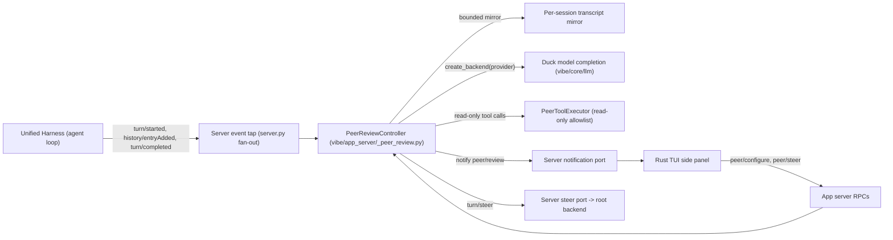

# Design Proposal: Rubber Duck Peer Review

**Tracking issue:** Not created

---

## 1. Background

The feature request: a "rubber duck" mode in which a secondary model reviews the
main model live while a turn runs, critiques its decisions peer-programmer
style, argues with it, and keeps it on track with the user's instructions and
plan. For example, Mistral Large as the main model with GLM 5.3 as the duck in
the background.

Accepted decisions from the design session (2026-10-24):

- **Delivery:** the duck's critique always streams to the UI; additionally,
  opt-in auto-steer injects strong critiques into the running turn so the main
  model hears them directly.
- **Cadence:** live, per step — the duck reviews as the turn progresses, with a
  configurable per-turn budget.
- **Control surface:** a `[utility_models] peer` config key sets the default
  duck model (empty = off); a `/peer` slash command toggles and re-models the
  duck per session.
- **Architecture:** an app-server feature module (Approach A below). No
  Runtime/Core (harness) changes.
- **UI:** a side panel (split view) in the Rust TUI, chosen from three layout
  options in a visual review.
- **Duck tool use:** read-only. The duck may read and search files and search
  or fetch the web to ground its critiques in evidence. It cannot write, edit,
  or run shell commands, and it cannot spawn subagents — if a critique would
  benefit from a subagent, the duck recommends it and the main model or the
  user decides.
- **Context:** independent. The duck has its own context — its own critic
  system prompt, the user's original instructions, a bounded mirror of new
  transcript material, and a concerns ledger (section 5). It never shares the
  main model's context window or system prompt, and the main model's
  compaction never affects it.

Adversarial implementation-readiness review (2026-10-25): completed by an
independent reviewer against the repo conventions and the source. Findings —
wire-method naming, interruption semantics, review timeouts, `steerable`'s
role, permission-bypass disclosure, and subagent visibility — are folded into
this revision.

## 2. Problem

A single model working a turn has no second opinion. It can drift off the
user's instructions, skip the plan, or take a risky action without anyone
challenging it until a human reads the transcript after the fact. Vibe has no
mechanism for a second model to observe a running session and advise on it.
Current adjacent behavior, source-confirmed:

- Secondary "utility" models exist but only for background one-shot completions
  (title generation, smart-approve classification, compaction, vision
  fallback). None observe the live turn.
- Post-hoc code review (`vibe/core/review/manager.py`) reviews file changes
  after they land; it does not review the model's reasoning or steer the turn.

## 3. Goals

- A configured secondary model observes every running turn live and produces a
  critique after each assistant/tool step, visible in the TUI while work is
  ongoing.
- With opt-in auto-steer, critiques at or above a severity threshold are
  injected into the running turn so the main model hears them.
- The duck can reference the user's original instructions and keep the main
  model on plan.
- The duck is advisory only: it cannot modify the workspace or execute
  commands. It may use a fixed read-only toolset (file read/search, web
  search/fetch) so its critiques are grounded in evidence rather than
  speculation.
- Cost is bounded: a configurable per-turn budget caps peer completions, and a
  per-review tool-round cap bounds tool use inside each completion.
- The duck keeps an independent context and a bounded concerns ledger, so it
  tracks open concerns across a turn without repeating itself and without
  sharing the main model's context window.
- The main turn is never blocked or failed by duck errors.

## 4. Non-Goals

- No harness (Unified Harness Core/Runtime) changes. In-loop peering, streaming
  token visibility, and pre-execution tool gating are a possible future
  deepening, not this version.
- The duck cannot write or edit files, run shell commands, or spawn subagents.
  Its toolset is a fixed read-only allowlist (section 5); it never receives
  approval-gated write tools, and the `task` (subagent) tool is excluded by
  design — the duck recommends subagents in its critique instead of running
  them.
- No ACP-specific rendering of critiques in v1; the `peer/review` notification
  is on the wire, but only the Rust TUI renders it.
- No cross-session duck memory; each session's duck starts fresh.
- No persistence of the per-session `/peer` override beyond the session.

## 5. Terminology and Constraints

- **Main model:** the session's active model (`active_model`).
- **Duck (peer model):** a secondary model configured via
  `[utility_models] peer`, used only for review completions.
- **Review:** one peer completion that critiques the transcript since the last
  review. A review has a structured verdict: `severity` (`info` | `warning` |
  `critical`), `steerable` (whether injecting it would help), and `text` (the
  critique).
- **Steer:** injecting a message into the running turn via the existing
  `turn/steer` RPC.
- **Budget:** max reviews per turn (`peer_review.max_reviews_per_turn`,
  default 10).
- **Read-only toolset:** the duck's fixed tool allowlist — `read_file`,
  `grep`, `web_search`, `web_fetch` — executed against the session workspace.
  Web tools are gated by `peer_review.allow_web_tools` (default `true`) and
  their queries are shown in the panel. Write/edit/shell/subagent tools are
  never in the allowlist.
- **Independent context:** the duck's own conversation context, constructed
  per review — never the main model's context window, system prompt, or
  compaction state. Built from: the critic system prompt, the user's original
  instructions, the transcript material new since the last review (bounded
  sliding window), and the concerns ledger.
- **Concerns ledger:** a controller-maintained, count-bounded (default 10)
  list of the duck's open critiques. It is the duck's memory across reviews:
  the duck sees which concerns are still open, judges whether newer steps
  addressed them, and closes them. Delivered steers are recorded here so the
  duck knows what landed.
- Constraints: the harness is an external dependency whose version skew
  app-server code must tolerate (the same discipline ADR 0014 applies to the
  client/backend boundary);
  new agent behavior belongs in an app-server feature module (ADR 0018);
  server-owned behavior ships behind app-server methods/notifications, with the
  TUI only rendering (ADR 0002, ADR 0009, ADR 0016); config changes follow
  layered configuration (ADR 0005); every feature ships telemetry (ADR 0008).

## 6. Current System and Evidence

Production path today: the Rust TUI speaks JSON-RPC to the app server
(`vibe/app_server/server.py`); the server drives one active session backend,
the `UnifiedHarnessBackendAdapter`
(`vibe/app_server/_unified_harness_backend_adapter.py`), which hosts the
external Unified Harness runtime that owns the agent loop. The server holds a
single event subscription per active backend and fans events out in
`_forward_backend_event` (`server.py:350`).

| Observation | Source | Verification status | Design consequence |
| :--- | :--- | :--- | :--- |
| Secondary model routing exists: `[utility_models] title / smart_approve` (`UtilityFeature` enum, `UtilityModelsConfig`) | `vibe/core/config/models.py:72-108`, `vibe/core/config/vibe_schema.py:528,1054` | Source-confirmed | Add `UtilityFeature.PEER` + `utility_models.peer`, reusing `get_utility_model` |
| Utility models are derived into runtime routes next to `active_model` | `vibe/app_server/_runtime.py:1357-1377` (`compaction_model`, `title_model`) | Source-confirmed | Peer model resolution follows the same path, but the peer call is made by the app server, not the runtime |
| The app server can call any configured model directly via `create_backend(provider=...)` | `vibe/core/llm/backend/factory.py` | Source-confirmed | The duck completion runs in app-server code with the peer's `ModelConfig` + provider |
| `turn/steer` injects a message into a running turn | `vibe/app_server/protocol.py:2402` (`TurnSteerParams`), `_unified_harness_backend_adapter.py:8125` (`steer_turn`) | Source-confirmed | Auto-steer and the manual "steer main" action reuse this RPC unchanged |
| Session events observable: `TurnStarted`, `TurnCompleted`, `HistoryEntryAdded`, `HistoryEntryUpdated` | `vibe/app_server/events.py:44-87`, fanned out in `server.py:344-380` | Source-confirmed | The controller taps the server's existing event fan-out; no second subscription |
| Per-session model override pattern: writes mirrored into the session `OverridesLayer` | `vibe/app_server/_session_model.py:24-95` | Source-confirmed | `/peer` persists its override the same way (`utility_models.peer` path) |
| Slash commands are declared in one registry | `vibe/cli-rust/src/commands/commands.rs:35` (`/model`) | Source-confirmed | `/peer` registers alongside `/model` |
| Feature prompts live as markdown in `vibe/core/prompts/` | `vibe/core/prompts/session_title.md`, `vision_describe.md` | Source-confirmed | The duck's critic prompt ships as `peer_review.md` |
| Post-hoc file review is a different feature (checkpoint-based change review) | `vibe/core/review/manager.py` | Source-confirmed | Out of scope; no reuse |
| Read-only builtins exist with no-prompt permission: `read_file` (ALWAYS), `grep` (ALWAYS); web tools `web_search` / `web_fetch` are ASK; `task` (subagents) is ASK | `vibe/core/tools/builtins/read_file.py:43`, `grep.py:17`, `web_search.py:26`, `web_fetch.py:53`, `task.py:31` | Source-confirmed | The duck's allowlist reuses these tool classes; web tools are auto-approved for the duck behind `allow_web_tools` (a flagged ADR 0004 deviation, see 7.8); `read_file`'s `sensitive_patterns` gate is denied for the duck, not bypassed; `task` is excluded |

## 7. Proposed Design

### 7.1 Decision Summary and High-Level Overview

An app-server feature module, `PeerReviewController`, observes the active
session's event stream, mirrors new history entries into a bounded transcript,
and runs review completions against the configured duck model through Vibe's
own LLM backend factory. Each review is emitted as a `peer/review`
notification (started, then completed — the same added/updated pattern as
history entries) and rendered in a new TUI side panel. When auto-steer is
enabled, reviews at or above the configured severity are injected into the
running turn with `turn/steer`; the panel also offers a manual per-critique
"steer main" action.

Normal path: user runs `/peer glm-5.3` (or config sets `[utility_models] peer`)
→ session starts a turn → `turn/started` arms the duck and resets the budget
→ each `history/entryAdded` is mirrored and coalesced → the duck model is
called with the critic prompt + the turn's user message + the bounded mirror →
`peer/review` (running) then `peer/review` (complete, verdict + text) → TUI
panel renders it → if auto-steer is on and severity crosses the threshold,
the text is steered into the turn → `turn/completed` retires the duck.

### 7.2 User and Product Behavior

- **Off by default.** No duck unless `[utility_models] peer` names a model or
  the user enables it.
- **`/peer`** with no argument shows current state; `/peer <model>` enables
  with that model for this session; `/peer off` disables. Mirrors `/model`.
- **Panel:** a toggleable right-hand split panel. Header shows the duck model
  and its provider, the count of open concerns, plus status ("reviewing step
  N", "reading auth.py…", "web search: …", "budget reached", "peer error: …").
  While a review runs, the panel shows the duck's read-only tool activity
  live, so its evidence gathering is transparent. Each
  critique shows severity, target step, text, and actions: *steer main*
  (injects into the running turn; disabled once the turn ends or the review is
  delivered) and *dismiss*. When closed, the main chat reclaims the width.
- **Auto-steer** (`peer_review.auto_steer`, default `false`): when on,
  reviews with `severity >= peer_review.auto_steer_severity` (default
  `critical`) **and** `steerable=true` are injected automatically; the panel
  marks them "delivered". `steerable` is the duck's own judgment that
  injecting the critique would help the running turn, and gates auto-steer
  only — the manual *steer main* action is always offered while the turn
  runs, regardless of `steerable`.
- **Degraded states:** peer provider errors mark the review failed and silence
  the duck for the rest of the turn; the main turn is unaffected. Budget
  exhaustion silences reviews but keeps the panel. A steer that arrives after
  the turn ended leaves the critique displayed and marked "not delivered".
- **Cancellation:** interrupting the turn cancels the in-flight peer call.

### 7.3 Architecture and Ownership

Ownership:

- `PeerReviewController` owns: enabled state, budget, mirror, coalescing,
  review scheduling, verdict parsing, steer decisions. Lives in
  `vibe/app_server/_peer_review.py` (ADR 0018 module owner).
- The server owns: the single backend subscription, the event tap seam, RPC
  dispatch, notification fan-out, controller lifecycle (create on backend
  activation, cancel on switch/shutdown).
- `vibe/core/config` owns: `utility_models.peer`, the `peer_review` settings
  group, and validation (unknown alias warnings, same-model-as-main warning).
- `vibe/core/llm` owns: the backend used for duck completions (unchanged).
- The TUI owns: panel presentation, `/peer`, key toggle, local panel state.
- Injected ports (ADR 0018 — narrow, no whole-server access): a config getter, a
  backend-event tap registration, a notify port, a steer port, a backend
  factory, and a `PeerToolExecutor` port that runs the read-only allowlist
  against the session workspace. The controller never reaches into another
  feature's state.

### 7.4 Contracts and Data

New wire shapes (all camelCase `ProtocolModel`s, `extra="forbid"`):

- Notification **`peer/review`** — `session_id`, `review_id`, `turn_id`,
  `target_entry_id` (history entry the review refers to, nullable),
  `status` (`running` | `complete` | `failed`), `severity`
  (`info` | `warning` | `critical`, nullable while running), `steerable`
  (bool), `delivered` (bool), `text` (string), `error` (string, nullable).
  Emitted twice per review (running → complete), mirroring
  `history/entryAdded` + `history/entryUpdated`.
- **`peer/configure`** — params `session_id`, `model` (string, nullable),
  `auto_steer` (bool, nullable); response `PeerConfigView` (`enabled`,
  `model`, `auto_steer`, `max_reviews_per_turn`, `auto_steer_severity`).
- **`peer/read`** — params `session_id`; response `PeerConfigView`.
- **`peer/steer`** — params `session_id`, `review_id`; injects that review's
  text into the running turn. Response `PeerSteerResponse` (`accepted`,
  `delivered`).

Config (layered, ADR 0005):

- `[utility_models] peer = "glm-5.3"` — duck model alias; empty = off.
  `UtilityFeature.PEER` added; `get_utility_model(PEER)` resolves it.
- `[peer_review]` group: `max_reviews_per_turn` (int, default 10, ge 1),
  `max_tool_rounds` (int, default 4, ge 0 — 0 means the duck may not use
  tools), `auto_steer` (bool, default false), `auto_steer_severity`
  (`info` | `warning` | `critical`, default `critical`), `allow_web_tools`
  (bool, default true — when false, `web_search`/`web_fetch` are removed from
  the duck's allowlist).

Duck completion contract: the duck model receives the read-only tool catalog
(`read_file`, `grep`, and — when `allow_web_tools` — `web_search`,
`web_fetch`) and its **independent context**, constructed per review as: the
critic system prompt (`vibe/core/prompts/peer_review.md`), the user's original
instructions for the turn, the transcript material new since the last review
(bounded sliding window, text-only), and the concerns ledger. The main
model's system prompt, thinking blocks, and context window are never included.
The controller runs a tool loop: each response's tool calls are executed
through a `PeerToolExecutor` port against the session workspace, results are
fed back, and the loop ends when the duck returns a final message or the
per-review tool-round cap is hit. The final message is parsed as a strict
JSON verdict (`{"severity": ..., "steerable": ..., "text": ...}`) with a
tolerant fallback to plain text at `severity=info`. Temperature comes from
the peer `ModelConfig`. Delivered steers are recorded in the ledger so the
duck's next review knows what landed.

Steer payload: a user-role message, text prefixed with a fixed marker
(`[rubber duck] `) so the main model can attribute the source.

### 7.5 Lifecycle, State, and Concurrency

- One controller per active root session, created on backend activation and
  cancelled on backend switch/shutdown (`cancel_tasks`, `_execution.py`).
- Per-turn state machine: `idle → armed (turn/started) → reviewing ⇄ coalescing
  → retired (turn/completed, any status)`. Interruption surfaces as
  `turn/completed` with turn status `interrupted` (there is no separate
  `turn/interrupted` notification); the controller distinguishes the two by
  turn status. Retirement stops new reviews; an in-flight review is cancelled
  when the turn ended by interruption, and allowed to finish (bounded by the
  review timeout) when the turn completed normally, so the final critique
  still displays with steer actions disabled.
- Coalescing: entries arriving while a review is in flight batch into the next
  review (trailing edge); at most one review in flight per session.
- Tool rounds are serialized inside a review (one round at a time) and capped
  by `max_tool_rounds`; a review with exhausted rounds still returns its
  verdict from whatever evidence it gathered.
- Budget decrements per completed review attempt (success, failure, or
  timeout), per turn.
- Each review attempt is bounded by a per-review timeout
  (`[peer_review] timeout_seconds`, default 60s) so a
  hung peer call cannot stall the duck: on timeout the controller emits a
  terminal `peer/review` (`failed`), counts the attempt against the budget,
  and silences the duck for the rest of the turn, like a provider error.
  Cancellation (interrupt, backend switch) likewise emits a terminal `failed`
  notification so the panel never shows a review stuck at `running`.
- Mirror bounds: the last N entries (`PEER_MIRROR_MAX_ENTRIES = 40`, a
  controller constant, not config) plus the turn's original user message,
  token-capped; images stripped from the mirror (text-only review). The
  ledger cap is likewise a controller constant (`PEER_LEDGER_MAX_CONCERNS =
  10`). The mirror covers root-session material only: when the main model
  runs `task`, the duck sees the tool call and result in the root transcript,
  not the child session's internal turns.
- The duck's context is independent of the main model's: the main model's
  compaction, context window size, and system prompt never affect it. The
  duck's own context is bounded — the mirror is a sliding window and the
  concerns ledger is count-capped (default 10); when full, the oldest closed
  concerns drop first, then the oldest open ones with a "superseded" note.
- Enabling mid-session starts the mirror fresh; the duck reviews from that
  point. Config reload re-resolves the peer model live; the enabled flag and
  budget survive.
- Idempotency: `peer/configure` and `peer/steer` are safe to repeat;
  `peer/steer` on an already-delivered review is a no-op returning
  `delivered=true`.

### 7.6 Failure Semantics

| Failure point | Caller result | Durable state | Recovery or retry |
| :--- | :--- | :--- | :--- |
| Peer provider error mid-review | `peer/review` status `failed` | Review counted against budget; duck silenced until next turn | Next turn re-arms; no automatic retry within the turn |
| Peer call hangs (no response, no error) | Review fails at `peer_review.timeout_seconds`; terminal `peer/review` status `failed` | Review counted against budget; duck silenced until next turn | Next turn re-arms |
| Peer model alias unknown | `peer/configure` fails with a typed validation error; config warns at load | Override not applied | User picks a valid alias |
| Budget exhausted | Panel shows "budget reached" | Counter persists for the turn | Resets on next `turn/started` |
| Steer rejected (turn ended) | Review stays displayed, `delivered=false` | Review record kept in panel | Manual re-steer disabled; user can paste the text |
| Turn interrupted | In-flight peer call cancelled; terminal `peer/review` (`failed`) emitted | Mirror kept; duck re-arms on next turn | `turn/started` of the next turn |
| Backend switch/shutdown | Controller cancelled | Nothing persisted | New session creates a fresh controller |
| Malformed duck output | Fallback parse: plain text, `severity=info`, `steerable=false` | Review still delivered | None needed |
| Duck tool call fails (missing file, network error) | Error text fed back to the duck as the tool result; review continues | Review record kept | Duck may retry within the round cap |
| Duck emits a call to a non-allowlisted tool | Refused with an error result (the catalog only advertises allowlisted tools; the executor double-checks) | Review continues | None — defense in depth |
| Tool-round cap hit mid-review | Verdict returned from gathered evidence | Review counted against budget | None |
| Duck context overflow | Sliding window drops oldest entries; ledger drops closed concerns first | Bounded context preserved | Review proceeds with the reduced context |

### 7.7 Compatibility and Migration

- Additive only: new config keys (empty defaults), new RPC family, new
  notification. No existing wire shape changes; clients that do not know
  `peer/review` ignore it per the existing notification policy.
- No persisted state to migrate. Sessions resumed mid-feature start with the
  duck disabled until configured.
- Settings Manager (Vibe Code managed config) and Le Chat Web backend
  allowlists must be checked for the new config fields before release; if the
  allowlist is closed, the fields stay CLI-local until updated.

### 7.8 Observability, Privacy, and Security

- **Telemetry (ADR 0008):** `vibe.peer_review.configured`,
  `vibe.peer_review.review_completed` (properties: severity, steerable,
  delivered, budget_remaining, duration — **never** critique text),
  `vibe.peer_review.steer_injected`, `vibe.peer_review.budget_exhausted`,
  `vibe.peer_review.error` (error class only). Verified locally with
  `DEBUG_LEVEL=1 uv run vibe`.
- **Privacy:** the transcript mirror is sent to the duck model's provider. This
  is the same trust boundary as the main model only when both share a
  provider; crossing providers sends session content to a second provider —
  the config warning for `peer` naming a different provider than the main
  model covers this, and the panel header always shows the duck's provider.
  Duck web queries can contain session-derived search terms and go to the
  configured search provider; `allow_web_tools=false` disables this, and every
  query is shown in the panel.
- **Security:** the duck receives a fixed read-only tool allowlist — no
  write/edit/shell tools, no `task` (subagents), no credentials beyond its
  provider's — so it cannot modify the workspace, execute commands, or
  escalate permissions. File tools run against the session workspace; reads
  that would trip `read_file`'s `sensitive_patterns` approval gate are
  **denied** for the duck — there is no interactive approval path for a
  background peer — so the duck's read visibility is the main model's minus
  sensitive files. Auto-approving the ASK-gated web tools behind
  `allow_web_tools` (default `true`) is a deliberate deviation from ADR
  0004's rule that side effects honor declared permissions: the duck is
  non-interactive, so ASK cannot be surfaced. The mitigations are the
  read-only allowlist, per-query visibility in the panel, and the
  `allow_web_tools` kill switch. Steer injection is a user-role message,
  which the main model treats as untrusted input like any user message.

## 8. Implementation Plan

| Slice | Behavior proved | Owner and likely files | Exit criteria |
| :--- | :--- | :--- | :--- |
| 1. Config | `[utility_models] peer` + `[peer_review]` group (`max_reviews_per_turn`, `max_tool_rounds`, `auto_steer`, `auto_steer_severity`, `allow_web_tools`) load, merge, validate, and resolve via `get_utility_model(PEER)` | `vibe/core/config/models.py`, `vibe_schema.py`, `_defaults.py`; tests under `tests/core/config/` | New keys round-trip through layers; unknown alias warns; pyright + unit tests pass |
| 2. Protocol | `peer/review` notification + `peer/configure` / `peer/read` / `peer/steer` RPCs validate on the wire and dispatch | `vibe/app_server/protocol.py`, `events.py`, `server.py` dispatch; contract tests | Malformed payloads rejected with typed errors; methods route to the module |
| 3. Controller + tool loop | Event tap → mirror → coalesced peer call with read-only tool loop → notification; budget; steer on threshold; read-only allowlist enforced | `vibe/app_server/_peer_review.py`, `vibe/core/prompts/peer_review.md`, `PeerToolExecutor` port; unit tests with `FakeBackend` | Fake-driven tests cover coalescing, budget, failure silence, steer trigger, interrupt cancel, tool-round cap, and refusal of non-allowlisted tools |
| 4. Session plumbing | `/peer` override lands in the session `OverridesLayer`; runtime derivation resolves the peer model; controller lifecycle follows backend activation | `vibe/app_server/_session_model.py` pattern, `_runtime.py`, `server.py` wiring | Session override survives reload, dies with the session; derivation test |
| 5. TUI | Side panel renders `peer/review`, `/peer` command, key toggle, steer/dismiss actions | `vibe/cli-rust/src/commands/`, `vibe/cli-rust/src/ui/`; `client-e2e` scenario + golden | Golden shows the panel; `/peer` round-trips; `make test_rust` passes |
| 6. Telemetry + docs | Events fire with approved properties; built-in `vibe` skill documents `/peer` and the config keys | `vibe/core/telemetry/`, `vibe/plugins/builtins/vibe/skills/vibe/SKILL.md` | `DEBUG_LEVEL=1` run shows events; skill updated |

No ADR changes required: the design stays inside ADR 0018's app-server module
rule and ADR 0002/0009's server-owned behavior boundary. No harness sibling
repository changes.

## 9. Validation Plan

- Every implementation slice meets its exit criteria (section 8).
- `uv run ruff check --fix .` and `uv run ruff format .` clean; report modified files.
- `uv run pyright` strict passes.
- Focused pytest slices per module, then `uv run pytest` full suite.
- Rust gates: `make test_rust QUIET=1`, then the new `client-e2e` golden.
- Manual: `DEBUG_LEVEL=1 uv run vibe` with a configured peer model — panel shows
  live critiques; auto-steer delivers a marked critique; telemetry lines appear.
- Settings Manager / Le Chat allowlist check completed or explicitly deferred.

Detailed validation checks

| Requirement or risk | Test level | Path or command | Expected result |
| :--- | :--- | :--- | :--- |
| Config keys merge across layers; unknown peer alias warns | Unit | `tests/core/config/` | Warnings emitted; resolution returns None |
| Protocol models reject unknown fields / bad enums | Contract | `tests/app_server/` protocol tests | `extra="forbid"` violations raise typed errors |
| Mirror + coalescing: burst of entries yields one review | Unit | `tests/app_server/test_peer_review.py` with `FakeBackend` | One peer call per burst; mirror bounded |
| Budget: N+1-th review is skipped | Unit | same | `budget_exhausted` telemetry; panel note |
| Peer error silences duck for the turn, main turn unaffected | Unit / Integration | same + server dispatch test | `peer/review` failed; turn completes normally |
| Hung peer call fails at the review timeout | Unit | same | Terminal `failed` emitted; attempt counted against budget |
| Auto-steer injects only at/above threshold | Unit | same | Steer port called with marked message |
| Steer after turn end marked not delivered | Unit | same | `delivered=false`; no exception |
| Interrupt cancels in-flight peer call | Unit | same | Task cancelled; duck re-arms next turn |
| Duck tool loop: results fed back, rounds capped | Unit | same | Final verdict produced; cap stops further rounds |
| Read-only enforcement: write/bash/task never advertised; forged call refused | Unit | same | Executor rejects non-allowlisted tool names |
| `allow_web_tools=false` removes web tools from the duck catalog | Unit | same + config test | Catalog contains only file tools |
| Duck context is independent and bounded | Unit | same | Context contains critic prompt + new material + ledger; never the main system prompt; window slides under pressure |
| Concerns ledger tracks and closes concerns across reviews | Unit | same | Open concerns persist; addressed concern closes; cap drops closed first |
| `/peer` override session-scoped | Integration | `tests/app_server/` | Override gone on new session |
| TUI panel + `/peer` end-to-end | End-to-end | `client-e2e` scenario + golden | Golden matches; commands round-trip |
| Telemetry events fire with approved properties, no critique text | Manual | `DEBUG_LEVEL=1 uv run vibe` | Log lines show events; PII scan of properties |

## 10. Alternatives

| Option | Advantages | Costs and risks | Decision crux |
| :--- | :--- | :--- | :--- |
| **A. App-server peer module (chosen)** | No harness changes; reuses config, backend factory, event stream, `turn/steer`; ships in this repo; testable with fakes | Duck sees completed entries, not streaming tokens; steering lands between model steps; event-stream latency | ADR 0018 prefers app-server code when existing Runtime capabilities express the feature — they do |
| B. Harness/Runtime-level peer | True in-loop peering; streaming visibility; could gate tool calls pre-execution | External dependency, version skew (ADR 0014), much larger blast radius; violates ADR 0018's default | Deferred; revisit only if pre-execution tool gating becomes a requirement |
| C. Subagent-based duck | Reuses subagent infra and per-agent models | Subagents are one-shot task runners, not continuous peers; lifecycle, cost accounting, and live cadence all fight the model | Wrong tool for a continuous observe-and-advise loop |

## 11. Rollout and Document Lifecycle

- **Release plan:** config + protocol + controller first (slices 1–4), TUI in
  the same release so the feature is usable; the feature is inert until a peer
  model is configured, so rollout is unconditional with no gating flag.
- **Compatibility removal:** none — additive only.
- **Monitoring plan:** telemetry events in section 7.8; watch
  `vibe.peer_review.error` rate and `review_completed` latency as the
  feature-specific signals.
- **Document lifecycle:** retain as the design record; if the peer loop later
  moves into the harness (Alternative B), this document is superseded by a new
  proposal and an ADR update.

---

## Appendix

### Source Map

- `vibe/core/config/models.py` — `UtilityFeature`, `UtilityModelsConfig` (extend with `PEER` / `peer`)
- `vibe/core/config/vibe_schema.py` — `utility_models` field, `get_utility_model` (extend)
- `vibe/core/llm/backend/factory.py` — `create_backend` (duck completions)
- `vibe/core/prompts/` — prompt markdown home for `peer_review.md`
- `vibe/core/telemetry/` — event emission per ADR 0008
- `vibe/app_server/_peer_review.py` — new controller module
- `vibe/app_server/protocol.py` — new RPCs + notification models
- `vibe/app_server/events.py` — event shapes the tap consumes
- `vibe/app_server/server.py` — event fan-out, dispatch, controller lifecycle
- `vibe/app_server/_session_model.py` — session override pattern to mirror
- `vibe/app_server/_runtime.py` — utility model derivation pattern
- `vibe/cli-rust/src/commands/commands.rs` — slash command registry (`/peer`)
- `vibe/cli-rust/src/ui/` — side panel widget
- `client-e2e/` — golden scenario
- `docs/adr/0002`, `0005`, `0008`, `0009`, `0014`, `0016`, `0018` — governing decisions
